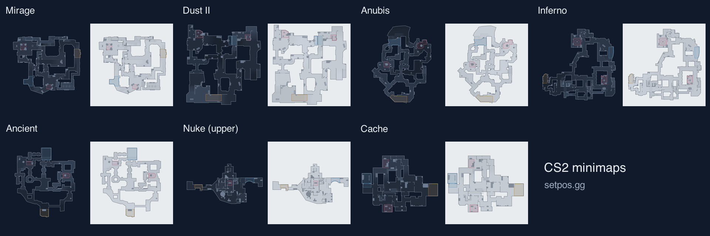
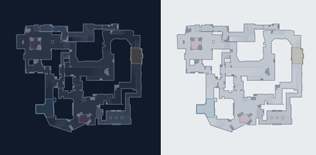
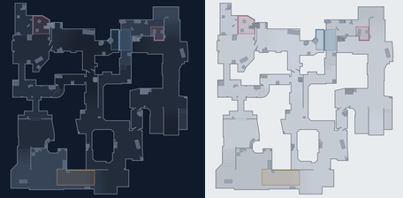
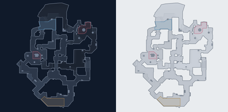
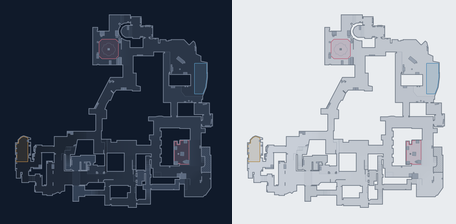
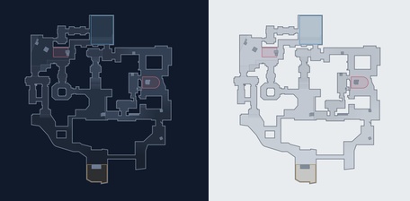
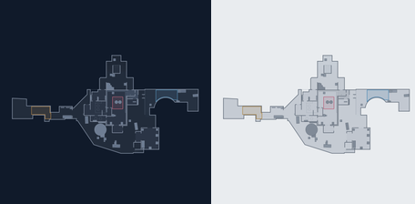
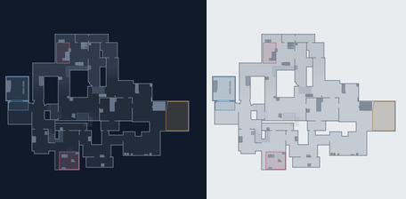

# CS2 minimaps

Vector minimaps drawn for [setpos.gg](https://setpos.gg), a Counter-Strike 2 lineup site.
Seven maps, each in dark and light colours, with transparent SVGs and 1024 / 2048 px PNGs.
Use them in a demo viewer, a match dashboard, a guide, or anything else that needs a map.

<!-- generated:preview -->

<!-- /generated:preview -->

Each pair shows dark on the left and light on the right. The drawings simplify cover and
show overlapping routes with dashed lines. Nuke is **upper level only**; there is no lower
level drawing in this repository. These are the drawings used on setpos.gg, not the game's
radar textures. They may lag behind map updates.

## Maps and downloads

Pick an SVG for scalable artwork, or a PNG for a fixed-size image. The artwork has a
transparent background: use the dark version on a dark surface and the light version on
a light surface. The previews include a background so both versions stay readable.

<!-- generated:maps -->
| Map | Preview | Dark files | Light files |
| --- | --- | --- | --- |
| [Mirage](https://setpos.gg/mirage) |  | [SVG](maps/mirage/mirage.svg) · [1024 PNG](maps/mirage/mirage-1024.png) · [2048 PNG](maps/mirage/mirage-2048.png) | [SVG](maps/mirage/mirage-light.svg) · [1024 PNG](maps/mirage/mirage-light-1024.png) · [2048 PNG](maps/mirage/mirage-light-2048.png) |
| [Dust II](https://setpos.gg/dust2) |  | [SVG](maps/dust2/dust2.svg) · [1024 PNG](maps/dust2/dust2-1024.png) · [2048 PNG](maps/dust2/dust2-2048.png) | [SVG](maps/dust2/dust2-light.svg) · [1024 PNG](maps/dust2/dust2-light-1024.png) · [2048 PNG](maps/dust2/dust2-light-2048.png) |
| [Anubis](https://setpos.gg/anubis) |  | [SVG](maps/anubis/anubis.svg) · [1024 PNG](maps/anubis/anubis-1024.png) · [2048 PNG](maps/anubis/anubis-2048.png) | [SVG](maps/anubis/anubis-light.svg) · [1024 PNG](maps/anubis/anubis-light-1024.png) · [2048 PNG](maps/anubis/anubis-light-2048.png) |
| [Inferno](https://setpos.gg/inferno) |  | [SVG](maps/inferno/inferno.svg) · [1024 PNG](maps/inferno/inferno-1024.png) · [2048 PNG](maps/inferno/inferno-2048.png) | [SVG](maps/inferno/inferno-light.svg) · [1024 PNG](maps/inferno/inferno-light-1024.png) · [2048 PNG](maps/inferno/inferno-light-2048.png) |
| [Ancient](https://setpos.gg/ancient) |  | [SVG](maps/ancient/ancient.svg) · [1024 PNG](maps/ancient/ancient-1024.png) · [2048 PNG](maps/ancient/ancient-2048.png) | [SVG](maps/ancient/ancient-light.svg) · [1024 PNG](maps/ancient/ancient-light-1024.png) · [2048 PNG](maps/ancient/ancient-light-2048.png) |
| [Nuke (upper)](https://setpos.gg/nuke) |  | [SVG](maps/nuke/nuke.svg) · [1024 PNG](maps/nuke/nuke-1024.png) · [2048 PNG](maps/nuke/nuke-2048.png) | [SVG](maps/nuke/nuke-light.svg) · [1024 PNG](maps/nuke/nuke-light-1024.png) · [2048 PNG](maps/nuke/nuke-light-2048.png) |
| [Cache](https://setpos.gg/cache) |  | [SVG](maps/cache/cache.svg) · [1024 PNG](maps/cache/cache-1024.png) · [2048 PNG](maps/cache/cache-2048.png) | [SVG](maps/cache/cache-light.svg) · [1024 PNG](maps/cache/cache-light-1024.png) · [2048 PNG](maps/cache/cache-light-2048.png) |
<!-- /generated:maps -->

[maps.json](maps.json) has each map's display name, calibration and relative file paths.
Its keys are the map slugs, such as `mirage` and `dust2`.

## Place a world position on the map

Every SVG has a `0 0 1024 1024` viewBox. Calibration uses the game's world coordinates:
`posX` / `posY` are the top-left origin, and `scale` is world units per radar pixel.
The image's Y axis points down, so subtract world Y from `posY`:

```text
u = (worldX - posX) / scale
v = (posY - worldY) / scale
```

For an image displayed at `width × height`, place the point at
`(u * width / radarSize, v * height / radarSize)`, relative to the image's top-left
corner. Keep the full square image when placing markers; cropping adds another offset.
The same formula works for the 2048 px PNGs by setting width and height to 2048.
Z is not used: positions on different floors can overlap, and the Nuke drawing does not
cover the lower floor.

JavaScript (after loading `maps.json`):

```js
function worldToImage(x, y, calibration, width = 1024, height = width) {
  const { posX, posY, scale, radarSize } = calibration;
  return {
    x: ((x - posX) / scale) * (width / radarSize),
    y: ((posY - y) / scale) * (height / radarSize)
  };
}

const maps = await (await fetch('./maps.json')).json();
const point = worldToImage(0, 0, maps.mirage.calibration);
// { x: 646, y: 342.6 }
```

Python:

```python
import json


def world_to_image(x, y, calibration, width=1024, height=None):
    if height is None:
        height = width
    return (
        (x - calibration["posX"]) / calibration["scale"]
        * width / calibration["radarSize"],
        (calibration["posY"] - y) / calibration["scale"]
        * height / calibration["radarSize"],
    )


with open("maps.json", encoding="utf-8") as source:
    maps = json.load(source)
point = world_to_image(0, 0, maps["mirage"]["calibration"])
# (646.0, 342.6)
```

## License and credit

The minimaps and calibration data are shared under
[Creative Commons Attribution 4.0 International](LICENSE). You can use and adapt them,
including commercially. Keep the credit and license link, and indicate any changes.
Ready-to-paste Markdown:

```markdown
Minimaps by setpos.gg (https://setpos.gg), licensed under
[CC BY 4.0](https://creativecommons.org/licenses/by/4.0/).
```

If you change the drawings, add a short note about what you changed. See the maps in use
at [setpos.gg](https://setpos.gg). For a correction, open an issue with the map name and
a screenshot of the area.

The images, manifest and download table are generated from the same source as the site.
The PNGs use lossless compression; the SVGs contain no embedded raster images or editor notes.

Counter-Strike 2 is a trademark of Valve Corporation. Not affiliated with Valve.
